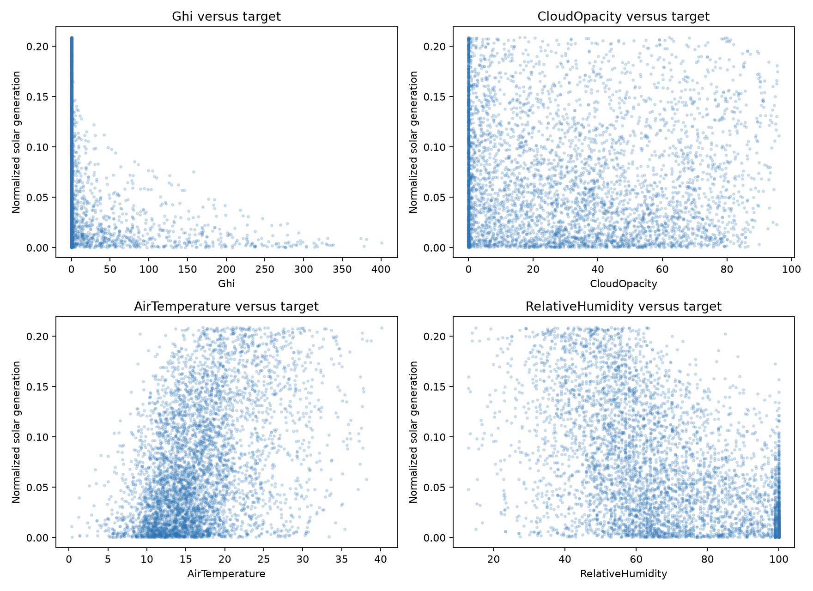
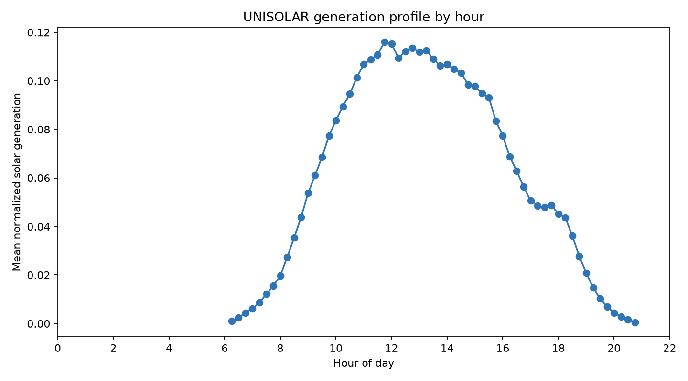
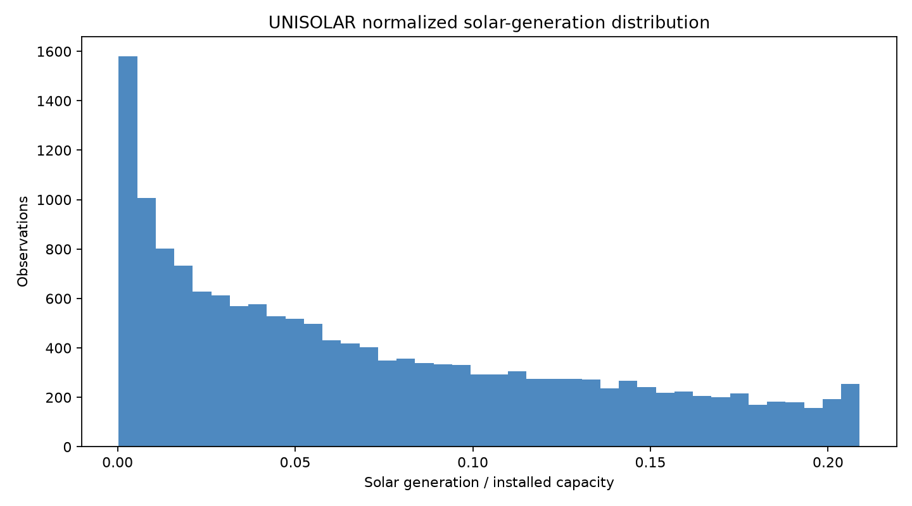
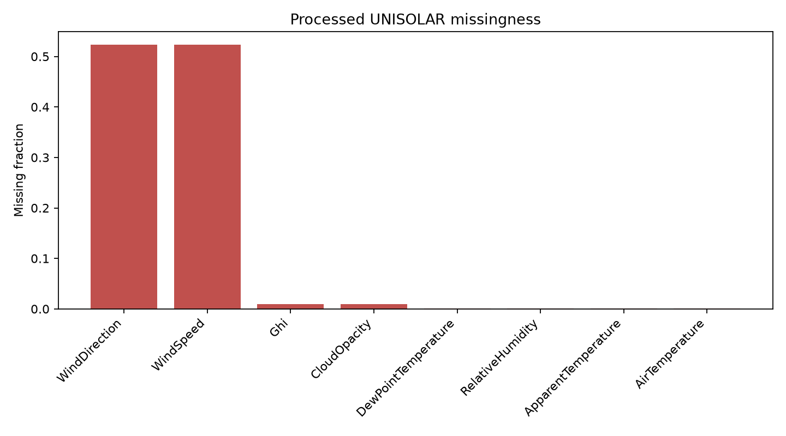
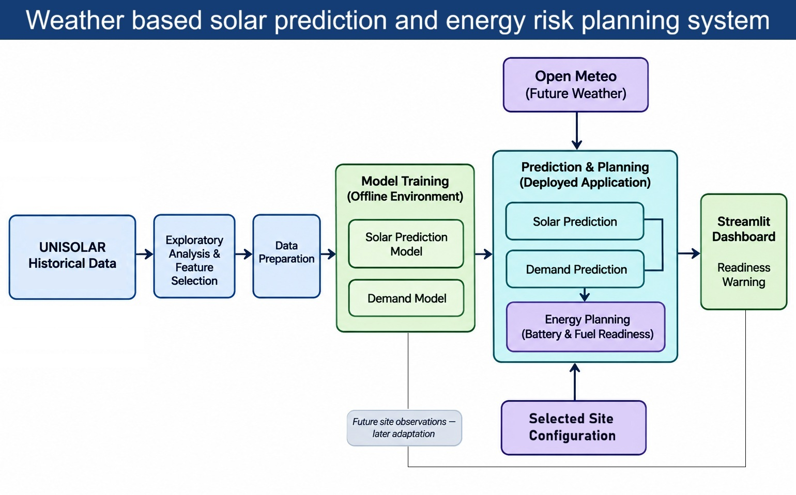

# CS5998 Milestone 2: Technical Checkpoint

## Weather based solar prediction and energy risk planning system

**Student:** Jeyaganeshan J. 258728C  
**Project repository:** [GitHub Repository](https://github.com/jeyakeethan/258728C-capstone-project.git)    
**Note:** Screenshots of the running dashboard attached at the end of the document 


## Content

#### 1. Project scope and purpose
#### 2. UNISOLAR data sources
#### 3. Exploratory Data Analysis
#### 4. Data preprocessing
#### 5. Baseline and improved method
#### 6. Deployment weather and prediction flow
#### 7. System architecture
#### 8. Limitations and trade offs
#### 9. Reproducible evidence commands

## 1. Project scope and purpose

The project is a weather based solar prediction and energy risk planning system. It predicts expected photovoltaic generation from weather and calendar information, predicts site demand using a supporting demand model, and simulates the hourly energy balance of solar, demand, battery reserve, and fuel backed energy.

The main prediction contribution in this milestone is the UNISOLAR solar generation model. The solar target is time indexed, but the deployed solar predictor is a supervised weather based regression model rather than an autoregressive solar time series model. The demand component is a supporting model trained from a synthetic historical demand dataset because measured site demand is not available.

The operational question is:

> Given a weather forecast and installed PV capacity, how much solar generation is expected, and when might the site require fuel backed electrical energy after solar and battery supply are considered?

**Scope limitation:** The UNISOLAR dataset originates from Australia, which experiences four distinct seasons and later solar sunset patterns, for example 6 PM and 8 PM during summer. Accordingly, the trained model cannot be applied directly to Sri Lanka without local data collection and retraining, and serves here as a conceptual solution demonstrating the forecasting and energy planning workflow.

## 2. UNISOLAR data sources

**Dataset repository:** [Unisolar Dataset Repository](https://github.com/CDAC-lab/UNISOLAR)

The exploratory analysis uses only the four UNISOLAR source files. The synthetic demand dataset and the retired demo solar trace are excluded from this analysis.

| Source file | Role in the project | Main use |
|---|---|---|
| `Solar_Generation_sub.csv` | Historical target observations | Provides `SolarGeneration`, which becomes `solar_power`. |
| `Weather_data_sub.csv` | Historical weather observations | Provides air temperature, apparent temperature, dew point, humidity, wind speed, and wind direction. |
| `Solar_Irradiance.csv` | Historical irradiance observations | Provides `Ghi` and `CloudOpacity`, the most deployment relevant radiation/cloud variables. |
| `Solar_Site_Details.csv` | Site metadata | Provides installed capacity (`kWp`) and location metadata. |

The reproducible file level summary is available at [raw_file_summary.csv](unisolar_eda/raw_file_summary.csv).

Current analysis facts:

- The processed UNISOLAR dataset contains 15,955 usable records.
- The source generation and weather files cover 2021.
- The current processed dataset contains one UNISOLAR site after preparation.
- The target is capacity normalized solar generation:

```text
normalized_solar = solar_power / site_capacity_kwp
```

## 3. Exploratory Data Analysis

### 3.1 EDA method

The EDA is reproducible through [eda_unisolar.py](../analysis/eda_unisolar.py). It performs the following steps:

1. Reads the four UNISOLAR source files.
2. Summarizes row counts, columns, date ranges, and missing cells.
3. Prepares or reloads the canonical UNISOLAR dataset.
4. Creates time features: hour, day of week, day of year, and month.
5. Creates cyclical encodings for daily and annual patterns.
6. Creates the capacity normalized target.
7. Calculates Pearson correlation, Spearman correlation, and mutual information for candidate features.
8. Produces hourly and monthly generation profiles.
9. Produces target distribution, feature relationship, and missingness figures.

The generated outputs are stored in [reports/unisolar_eda](unisolar_eda).



### 3.2 Target behaviour

The target varies strongly by time of day. The generated hourly profile shows low generation in the early morning, a broad daytime maximum, and a decline toward the evening. This supports using hour and cyclical daily features.

The target also changes across months, so annual calendar features are retained.
Solar generation by hour            |  Solar distribution
:-------------------------:|:-------------------------:
  |  

The hourly and monthly summaries are available in:
- [hourly_profile.csv](unisolar_eda/hourly_profile.csv)
- [monthly_profile.csv](unisolar_eda/monthly_profile.csv)

### 3.3 Feature relationships

The association analysis produced the following useful signals:

| Feature | Pearson association | Spearman association | Mutual information | Decision |
|---|---:|---:|---:|---|
| `hour` | 0.008 | 0.019 | 0.402 | Retain through time and cyclical features. |
| `hour_sin` | -0.091 | -0.046 | 0.330 | Retain; captures the daily cycle continuously. |
| `hour_cos` | -0.490 | -0.560 | 0.300 | Retain; captures the daily cycle continuously. |
| `day_of_year` | 0.038 | 0.032 | 0.124 | Retain for annual seasonality. |
| `RelativeHumidity` | -0.488 | -0.487 | 0.162 | Retain; available from the deployment API. |
| `AirTemperature` | 0.428 | 0.421 | 0.135 | Retain; available from the deployment API. |
| `Ghi` | -0.295 | -0.420 | 0.127 | Retain; physically important and API available. |
| `CloudOpacity` | -0.070 | -0.091 | 0.030 | Retain as a deployment compatible cloud proxy. |

The full table is available in [feature_associations.csv](unisolar_eda/feature_associations.csv).

The correlation signs should not be interpreted as causal effects. Solar generation is strongly affected by the interaction between irradiance, time of day, cloud conditions, and seasonal position. Mutual information and model validation are therefore used alongside simple correlation statistics.

### 3.4 Feature selection decision

The final deployed solar features are:

```text
Ghi, CloudOpacity, AirTemperature, RelativeHumidity,
hour, day_of_week, day_of_year, month,
hour_sin, hour_cos, doy_sin, doy_cos
```

The selection follows three constraints:

1. The feature must have a plausible relationship with PV output.
2. The feature must be available, or have a clearly documented equivalent, at deployment time.
3. The feature must improve or support generalization under chronological validation.

Wind speed, wind direction, apparent temperature, dew point, identifiers, and site coordinates were not selected for the deployed predictor. Wind variables have substantial remaining missingness after interpolation, and several source variables do not have a direct, consistently mapped Open Meteo deployment input. Site identifiers and coordinates are metadata rather than direct hourly weather predictors.

The processed missingness evidence is available in [processed_missingness.csv](unisolar_eda/processed_missingness.csv). The relationship plots are available in [feature_relationships.png](unisolar_eda/feature_relationships.png).

<div align="center">

</div>

## 4. Data preprocessing

Preprocessing is implemented in [prepare_unisolar.py](../workflows/prepare_unisolar.py).

### 4.1 Solar generation Data (Solar_Generation_sub.csv)

The generation file is loaded and validated for `CampusKey`, `SiteKey`, `Timestamp`, and `SolarGeneration`. The timestamp is parsed and normalized, and `SolarGeneration` is converted to numeric `solar_power`.

### 4.2 Weather data (Weather_data_sub.csv)

Weather records are parsed by timestamp and campus. The weather table is deduplicated by timestamp and campus, then merged with generation using a many to one timestamp/campus relationship.

### 4.3 Solar irradiance data (Solar_Irradiance.csv)

The irradiance table is parsed from `Timestamp_UTC`. Campus names are mapped to the UNISOLAR campus keys. `Ghi` and `CloudOpacity` are merged into the generation weather table by timestamp and campus.

### 4.4 Solar site metadata (Solar_Site_Details.csv)

Site details are joined by `SiteKey`. Installed capacity (`kWp`) is retained so generation can be normalized across capacity. Latitude and longitude are retained as metadata for later deployment/adaptation analysis.

### 4.5 Missing value handling and canonical output

Dynamic weather and irradiance fields are sorted within each site and linearly interpolated only for short internal gaps, up to the configured 60 minute limit. Gaps longer than that limit, and gaps at the start or end of a series, remain missing in the canonical CSV. Invalid timestamps and invalid target rows are removed, and duplicate site/timestamp rows are resolved. Remaining NaNs in the selected weather inputs (`Ghi`, `CloudOpacity`, `AirTemperature`, `RelativeHumidity`) are filled later by `SimpleImputer` in the training pipeline.

The resulting canonical file is [data/processed/unisolar.csv](../data/processed/unisolar.csv). It is the input to the solar model training workflow.

### 4.6 Day Grouped Random Split (70% / 15% / 15%)

The training workflow in [train_unisolar_weather_model.py](../workflows/train_unisolar_weather_model.py) partitions the dataset by whole calendar days into **70% Training**, **15% Validation**, and **15% Test** sets using a reproducible day grouped random split:

1. Valid solar generation records are sorted chronologically and grouped by calendar date.
2. First, 15% of whole calendar days are held out as an untouched test set.
3. Next, the remaining 85% of days are split into the training set (70% of all days) and validation set (15% of all days) using a fixed random seed for reproducibility.

#### Rationale for Day Grouped Splitting

1. **Full Annual Seasonal Coverage:** Because the processed UNISOLAR dataset covers a single calendar year (January to December 2021, spanning 359 unique days), holding out a contiguous block at the end of the year would exclude late autumn and early winter solar angles and seasonal weather conditions from model training. Sampling whole days across the entire year ensures that all 12 months are represented in the training, validation, and test partitions.
2. **Alignment with Weather Driven Estimation:** The solar model predicts instantaneous generation from sun position geometry (time of day and day of year) and concurrent weather conditions rather than past generation lags, making full year seasonal coverage essential for generalization.
3. **Prevention of Intra Day and Cross Site Leakage:** Grouping by calendar date guarantees that all sites sharing a timestamp and all consecutive 15 minute intervals within the same day remain together in a single partition. This prevents the model from interpolating neighboring intra day readings or leaking concurrent site observations across partitions.

#### Partition Summary

| Partition | Grouping Rule | Target Share | Unique Days | Months Covered | Records (Actual Share) | Date Span |
|---|---|---:|---:|---:|---:|---|
| Training | Randomly sampled whole days (seed 42) | 70% | 251 | 12 | 11,148 (69.87%) | 2021-01-01 to 2021-12-31 |
| Validation | Randomly sampled whole days (seed 42) | 15% | 54 | 12 | 2,430 (15.23%) | 2021-01-08 to 2021-12-17 |
| Test | Held out whole days (seed 42) | 15% | 54 | 12 | 2,377 (14.90%) | 2021-01-06 to 2021-12-28 |
| **Total** | **All calendar days grouped across splits** | **100%** | **359** | **12** | **15,955 (100.00%)** | **2021-01-01 to 2021-12-31** |

Hyperparameter selection uses only the training and validation partitions. Once the best configuration is selected, the model is refit on the combined training and validation data (85%, 305 days / 13,578 records) and evaluated once on the held out test partition.

## 5. Baseline and improved method

### 5.1 Baseline: historical only solar prediction

The baseline scenario is the ordinary approach of trying to predict future solar generation from past generation records and calendar patterns alone. Historical solar data can reveal typical daily and seasonal behaviour, but it cannot observe the future cloud cover, irradiance, temperature, or humidity that determine the next forecast period.

This is a limitation baseline rather than a separate deployed model. It establishes the problem that the project must solve: historical data alone cannot provide timely information about weather driven changes in available solar power.

### 5.2 Improved method: weather informed HistGradientBoostingRegressor

The implemented solution addresses that limitation by supplying future weather forecast values from Open Meteo as model inputs. The trained UNISOLAR model uses the deployment compatible features `Ghi`, `CloudOpacity`, `AirTemperature`, `RelativeHumidity`, and cyclical time features.

The improved predictor is a `HistGradientBoostingRegressor` pipeline with median imputation for values that remain missing after the 60 minute interpolation. It can represent nonlinear interactions between irradiance, cloud conditions, temperature, humidity, and cyclical time features. The engineering improvement is therefore the complete weather informed pipeline: feature selection, capacity normalized training target, external forecast inputs, and tuned nonlinear regression.

The training workflow evaluates 48 HGB parameter combinations on the chronological validation partition. The selected configuration is:

```text
learning_rate = 0.03
max_iter = 200
max_leaf_nodes = 15
min_samples_leaf = 20
l2_regularization = 0.0
```

The final HGB model is refit on the combined training and validation data, then evaluated once on the untouched test partition.

### 5.3 Error analysis and evaluation

Because the baseline is a problem framing reference rather than a separately implemented estimator, the evaluation focuses on the actual weather informed model and its chronological holdout performance. Metrics are reported in normalized solar generation ratio units.

| Partition | Weather informed HGB | MAE | RMSE | R² |
|---|---|---:|---:|---:|
| Validation | HGB | 0.03228 | 0.04161 | 0.56261 |
| Test | HGB | 0.02535 | 0.03461 | 0.72814 |
| Final seven test days | HGB | 0.02138 | 0.02833 | 0.83464 |

The HGB configuration was selected using validation MAE with RMSE as a tie breaker. The final test partition was not used for tuning. The error results show how accurately the weather informed model predicts normalized generation on unseen chronological observations; they do not prove that the model is universally accurate at a new location.

The generated end of dataset evidence is available in [unisolar_end_fit.png](../models/unisolar_end_fit.png) and [unisolar_end_fit.csv](../models/unisolar_end_fit.csv). The model metadata is stored in [unisolar_weather_forecaster.json](../models/unisolar_weather_forecaster.json).

## 6. Deployment weather and prediction flow

At deployment time, [weather_api.py](../src/weather_api.py) requests hourly values from Open Meteo:

| API value | Model feature | Role |
|---|---|---|
| `shortwave_radiation` | `Ghi` | Irradiance input. |
| `cloud_cover` | `CloudOpacity` proxy | Cloud condition input. |
| `temperature_2m` | `AirTemperature` | Temperature input. |
| `relative_humidity_2m` | `RelativeHumidity` | Humidity input. |

The dashboard creates the same time features used during training, predicts normalized solar generation, and scales the prediction by configured installed capacity. The forecast is then combined with the supporting demand prediction and passed to hourly battery/fuel planning.

The external API is a deployment input, not the training dataset. The model was trained on historical UNISOLAR observations, so provider differences and geographic transfer are treated as limitations.

## 7. System architecture

<!--
Source - https://stackoverflow.com/q/41604263
Posted by zjffdu, modified by community. See post 'Timeline' for change history
Retrieved 2026-11-27, License - CC BY-SA 4.0
-->



The diagram separates research data preparation from deployment inputs. Historical UNISOLAR files train and evaluate the solar model. Open Meteo supplies future weather at inference time. The supporting demand model supplies site demand estimates, and the planning layer converts both predictions into battery and fuel readiness outcomes.

The same diagram is available as a standalone Mermaid source file at [high_level_architecture.jpg](high_level_architecture.jpg).

## 8. Limitations and trade offs

- The available UNISOLAR data currently represents one processed site, limiting geographic generalization.
- The deployment location may differ from the historical training location.
- Open Meteo fields are mapped to UNISOLAR concepts, including cloud cover as a proxy for `CloudOpacity`.
- The demand model is trained on synthetic demand because measured site demand is unavailable.
- Battery telemetry is unavailable, so present reserve is estimated from a starting reserve assumption and forecast replay.
- Battery efficiency, degradation, minimum state of charge, and charge/discharge power limits are outside this milestone.
- Correlation and mutual information identify association, not causation.
- The model produces point predictions; uncertainty intervals and calibrated risk probabilities are future improvements.

## 9. Reproducible evidence commands

Run the UNISOLAR EDA:

```powershell
.venv\Scripts\python.exe analysis\eda_unisolar.py
```

Prepare and train the solar model:

```powershell
.venv\Scripts\python.exe workflows\prepare_unisolar.py
.venv\Scripts\python.exe workflows\train_unisolar_weather_model.py
```